# Data Structures & Algorithms in C++

[](https://isocpp.org/) [](#topics-covered) [](#) [](#)

Welcome to my **C++ Data Structures & Algorithms** reference repository! This repository contains structured study notes, visual diagrams, and clean C++ implementations designed for deep conceptual mastery and practical problem solving.

> **Learning Source:** Playlist by *MyCodeSchool* (YouTube)
>
> **Author:** Kamal Aboueid

## Repository Overview

This repository contains:
- Detailed conceptual notes (English & Arabic).
- Custom C++ implementations written and dry-run manually.
- Clean, documented C++ source code.

---

## Topics Covered

### 1. Introduction to Data Structures
- **Concept:** What is a Data Structure? Why do we need structured memory management?
- **Classification:** Linear (Arrays, Linked Lists, Stacks, Queues) vs. Non-Linear (Trees, Graphs).
- **Key Takeaways:**
    - Choosing the right data structure optimizes time complexity ($O(1)$, $O(n)$) and memory space.

### 2. Arrays vs. Lists (Contiguous vs. Sequential Memory)

> Arrays provide cache-friendly contiguous indexing, while Linked Lists offer flexible dynamic node allocation.
- **Arrays (Static):**
  - Continuous block of memory allocation.
  - Direct access via index in $O(1)$ time.
  - Fixed size (cannot dynamically grow/shrink at runtime).
- **Dynamic Arrays (`std::vector`):**
  - Dynamic size expansion with geometric doubling (amortized $O(1)$ push-back).
  - Cache locality preserves ultra-fast indexing ($O(1)$ direct access).

---
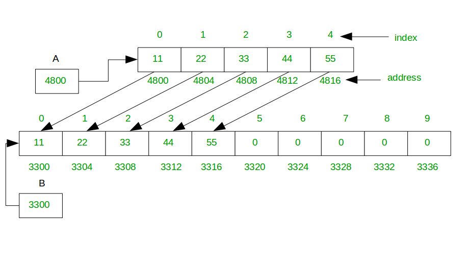
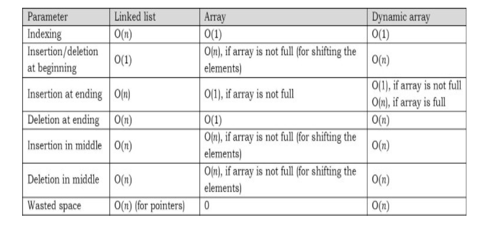


---

### 3. Linked List Theory
 > A **Linked List** is a linear data structure where elements (nodes) are stored in non-contiguous heap memory, linked dynamically through explicit pointer references.

 - Linked lists store elements dynamically in memory.
 - Each element is called a node.
 - Nodes are connected using pointers.
 - Linked List Representation
 - A linked list is represented by a pointer called head, which points to the first node of the list. Each node typically contains:

 - Data: Stores the actual value.
 - Next Pointer: Stores the address of the next node
 ```cpp
    // Node Structure Definition
    struct Node {
        int data;
        Node* next;
    };
 ```
```cpp
// Insert at the front of the list - O(1)
void insertAtBegin(Node *&head, int value) {
    Node *newNode = new Node(); // Allocate heap memory for new node
    newNode->data = value;
    newNode->next = head;
    head = newNode;
}

 ```
- **data**: Stores the value or payload of the current node.
- **next**: Stores the memory address of the subsequent node.
- **tail node**: The final node always points to `nullptr` (marking list termination).
  <br>
  - Static array ,  dynamic array ,  linked list


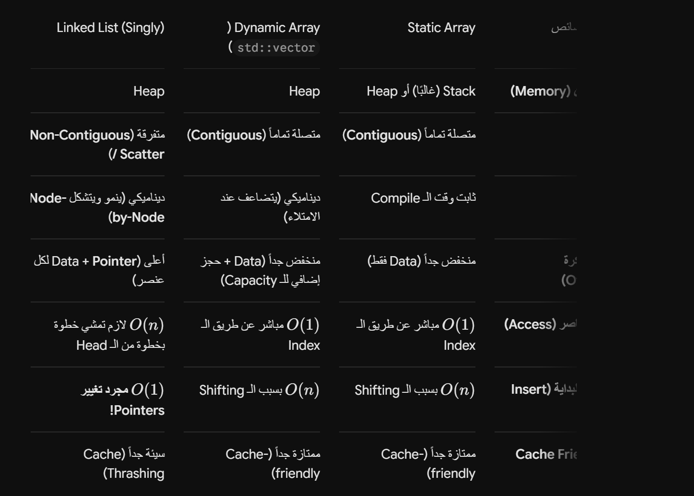
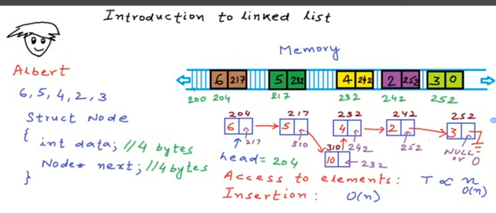
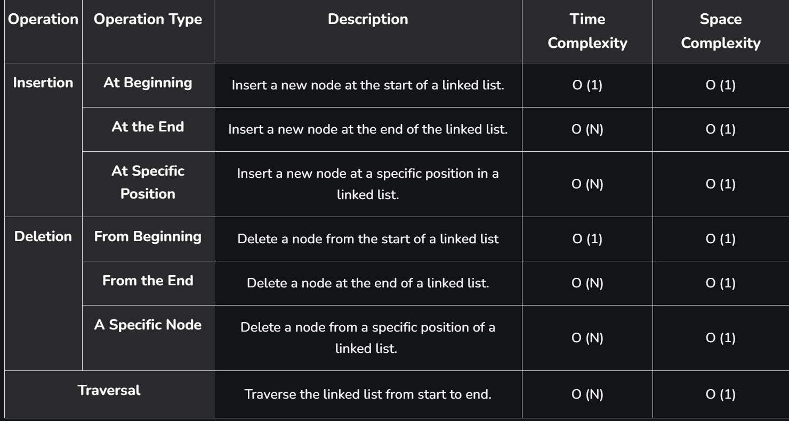
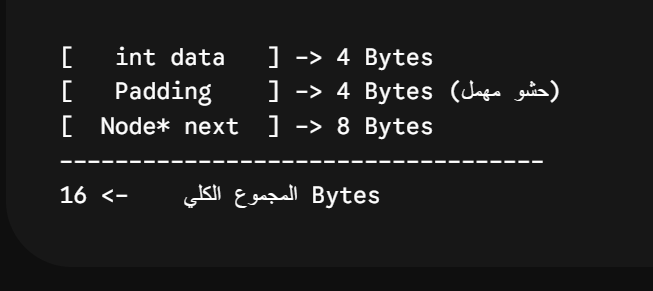


## Singly Linked List Implementation in C++

A comprehensive guide to fundamental **Linked List** concepts, memory layout, and core operations in C++.

---

### 1. Node Structure & Memory Layout

A standard Node consists of two parts:
1. **Data**: The payload value (`int`, `double`, `char`, etc.).
2. **Next Pointer (`*next`)**: A pointer holding the memory address of the subsequent node.

### Memory Alignment & Padding
On a **64-bit architecture**:
* Pointer size = **8 Bytes**.
* Integer (`int`) size = **4 Bytes**.
* **Actual size (`sizeof(Node)`) = 16 Bytes** (not 12 Bytes).

> **Why 16 Bytes?**
>
> The compiler inserts **4 Bytes of padding** after the integer so that the 8-byte pointer aligns on an 8-byte memory boundary, allowing the CPU to read data in optimal memory cycles.

```cpp
struct Node {
    int data;     // 4 Bytes
    // 4 Bytes Padding added automatically by compiler
    Node* next;   // 8 Bytes
};
// sizeof(Node) == 16 Bytes
```
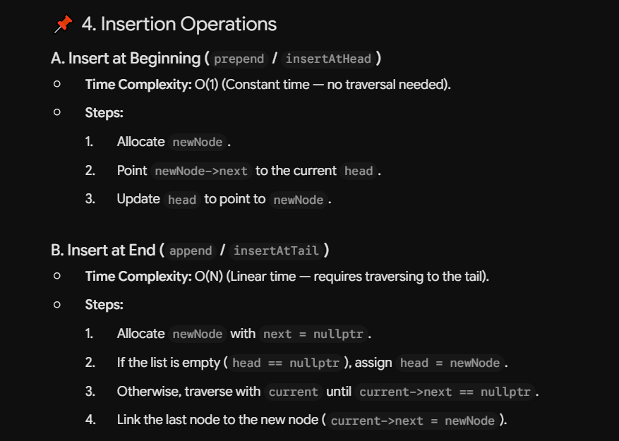
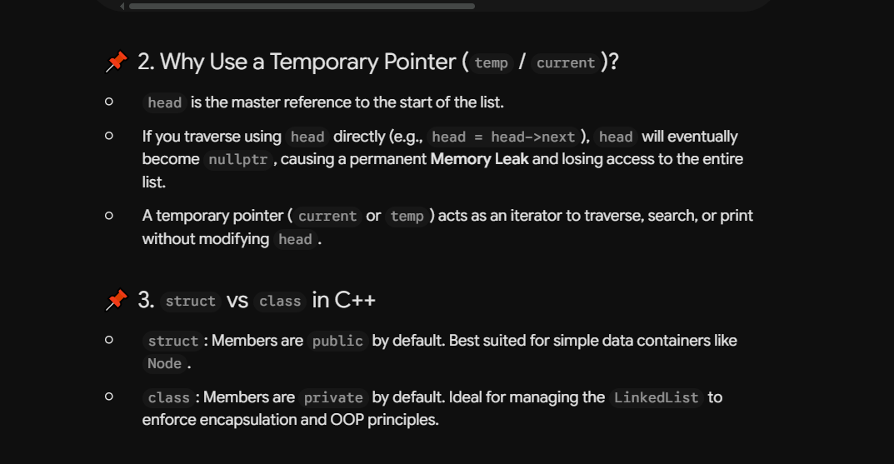

 ```cpp
#include <iostream>
using namespace std;

// 1. Node Definition
struct Node {
    int data;
    Node *next;

    Node() : data(0), next(nullptr) {}
    Node(int value) : data(value), next(nullptr) {}
};

// 2. Linked List Manager Class
class LinkedList {
public:
    Node *head;

    LinkedList() : head(nullptr) {}

    // Insert at Head - O(1)
    void prepend(int value) {
        Node *newNode = new Node(value);
        newNode->next = head;
        head = newNode;
    }

    // Insert at Tail - O(N)
    void append(int value) {
        Node *newNode = new Node(value);

        if (head == nullptr) {
            head = newNode;
            return;
        }

        Node *current = head;
        while (current->next != nullptr) {
            current = current->next;
        }
        current->next = newNode;
    }

    // Display List - O(N)
    void display() const {
        Node *current = head;
        while (current != nullptr) {
            cout << current->data << " -> ";
            current = current->next;
        }
        cout << "NULL\n";
    }

    // Destructor to prevent Memory Leaks
    ~LinkedList() {
        Node *current = head;
        while (current != nullptr) {
            Node *next = current->next;
            delete current;
            current = next;
        }
    }
};

int main() {
    LinkedList list;

    // Append elements to tail
    list.append(10);
    list.append(20);
    list.append(30);

    // Prepend element to head
    list.prepend(40);

    // Output: 40 -> 10 -> 20 -> 30 -> NULL
    list.display();

    return 0;
}
```

## Singly Linked List: Insertion Operations & Complexity Guide

A complete reference covering all insertion techniques in a Singly Linked List, including time complexity analysis, pointer manipulation rules, and full C++ implementation.

---

### 1. Insertion Techniques Overview

- **Insert at Front (Head):** `prepend(val)`, time $O(1)$, space $O(1)$. Updates the head pointer directly without traversing the list.
- **Insert at End (Tail):** `append(val)`, time $O(N)$, space $O(1)$. Traverses to the node whose `next` pointer is `nullptr`.
- **Insert After Value:** `insertAfter(target, val)`, time $O(N)$, space $O(1)$. Searches for `target`, then inserts immediately after it.
- **Insert at Position:** `insertAtPosition(pos, val)`, time $O(N)$, space $O(1)$. Traverses to node `pos - 1`, then links the new node in place.

---

### 2. The Golden Rule of Pointer Linking

When inserting a node anywhere in the middle or end:
1. **Link the new node to the rest of the list first:**
   ```cpp
   newNode->next = current->next;
    ```


- Supported operations: insertion at the beginning, end, after a value, and at a position.
```cpp
 #include <iostream>
using namespace std;

// Node Structure
struct Node {
    int data;
    Node *next;

    Node() : data(0), next(nullptr) {}
    Node(int value) : data(value), next(nullptr) {}
};

// Linked List Class
class LinkedList {
public:
    Node *head;

    LinkedList() : head(nullptr) {}

    // 1. Insert at Beginning (Front) - O(1)
    void prepend(int value) {
        Node *newNode = new Node(value);
        newNode->next = head;
        head = newNode;
    }

    // 2. Insert at End (Tail) - O(N)
    void append(int value) {
        Node *newNode = new Node(value);
        if (head == nullptr) {
            head = newNode;
            return;
        }

        Node *current = head;
        while (current->next != nullptr) {
            current = current->next;
        }
        current->next = newNode;
    }

    // 3. Insert After a Given Target Value - O(N)
    void insertAfter(int targetValue, int newValue) {
        Node *current = head;
        while (current != nullptr && current->data != targetValue) {
            current = current->next;
        }

        if (current == nullptr) {
            cout << "Value " << targetValue << " not found in the list!\n";
            return;
        }

        Node *newNode = new Node(newValue);
        newNode->next = current->next;
        current->next = newNode;
    }

    // 4. Insert at a Specific 1-Based Position - O(N)
    void insertAtPosition(int position, int newValue) {
        if (position < 1) {
            cout << "Invalid position!\n";
            return;
        }

        if (position == 1) {
            prepend(newValue);
            return;
        }

        Node *current = head;
        for (int i = 1; i < position - 1 && current != nullptr; i++) {
            current = current->next;
        }

        if (current == nullptr) {
            cout << "Position " << position << " is out of bounds!\n";
            return;
        }

        Node *newNode = new Node(newValue);
        newNode->next = current->next;
        current->next = newNode;
    }

    // Display List Traversal - O(N)
    void display() const {
        Node *current = head;
        while (current != nullptr) {
            cout << current->data << " -> ";
            current = current->next;
        }
        cout << "NULL\n";
    }

    // Destructor to clean up dynamic memory
    ~LinkedList() {
        Node *current = head;
        while (current != nullptr) {
            Node *next = current->next;
            delete current;
            current = next;
        }
    }
};

int main() {
    LinkedList list;

    // 1. Append (End): 10 -> 20 -> 30 -> NULL
    list.append(10);
    list.append(20);
    list.append(30);

    // 2. Prepend (Front): 40 -> 10 -> 20 -> 30 -> NULL
    list.prepend(40);

    // 3. Insert After Value: 40 -> 77 -> 10 -> 20 -> 30 -> NULL
    list.insertAfter(40, 77);

    // 4. Insert at Position: 40 -> 77 -> 99 -> 10 -> 20 -> 30 -> NULL
    list.insertAtPosition(3, 99);

    list.display();

    return 0;
}
```


## Singly Linked List: Deletion Operations & Complexity Guide

A complete reference covering all deletion techniques in a Singly Linked List, including time complexity analysis, boundary condition handling, dynamic memory deallocation (`delete`), and complete C++ implementation.

---

### 1. Deletion Techniques Overview

- **Delete from Front (Head):** `deleteHead()`, time $O(1)$, space $O(1)$. Advances `head` and frees the old first node.
- **Delete from End (Tail):** `deleteTail()`, time $O(N)$, space $O(1)$. Traverses to the second-to-last node and deallocates the tail.
- **Delete by Value:** `deleteByValue(target)`, time $O(N)$, space $O(1)$. Finds the node before `target`, updates the links, and deletes the target node.
- **Delete at Position:** `deleteAtPosition(pos)`, time $O(N)$, space $O(1)$. Traverses to node `pos - 1`, bypasses the target node, and deletes it.

---

### 2. Core Deletion Rules & Memory Safety

1. **Avoid Memory Leaks:** Always store the target node in a temporary pointer (e.g., `Node* temp = head;`) before shifting links, then explicitly call `delete temp;`.
2. **Prevent Dangling Pointers:** When deleting the tail, ensure the new last node explicitly points to `nullptr` (`current->next = nullptr;`).
3. **The `current->next->next` Condition:** Used during tail deletion to stop at the second-to-last node without losing the backward linking context.
4. **Boundary Checks:** Always handle edge cases:
   * The list is completely empty (`head == nullptr`).
   * The list contains only a single node (`head->next == nullptr`).
   * The requested value/position does not exist in the list.

---

### 3. Complete C++ Implementation

```cpp
#include <iostream>
using namespace std;

// 1. Node Structure
struct Node {
    int data;
    Node *next;

    Node() : data(0), next(nullptr) {}
    Node(int value) : data(value), next(nullptr) {}
};

// 2. Linked List Manager Class
class LinkedList {
public:
    Node *head;

    LinkedList() : head(nullptr) {}

    // Helper: Insert at End to build list for testing
    void append(int value) {
        Node *newNode = new Node(value);
        if (head == nullptr) {
            head = newNode;
            return;
        }
        Node *current = head;
        while (current->next != nullptr) {
            current = current->next;
        }
        current->next = newNode;
    }

    // ==========================================
    // 1. Delete from Beginning (Head) - O(1)
    // ==========================================
    void deleteHead() {
        if (head == nullptr) {
            cout << "List is already empty!\n";
            return;
        }

        Node *temp = head;
        head = head->next;
        delete temp;
    }

    // ==========================================
    // 2. Delete from End (Tail) - O(N)
    // ==========================================
    void deleteTail() {
        if (head == nullptr) {
            cout << "List is already empty!\n";
            return;
        }

        // Case: Only 1 node exists
        if (head->next == nullptr) {
            delete head;
            head = nullptr;
            return;
        }

        // Stop at the second-to-last node
        Node *current = head;
        while (current->next->next != nullptr) {
            current = current->next;
        }

        delete current->next;
        current->next = nullptr;
    }

    // ==========================================
    // 3. Delete by Target Value - O(N)
    // ==========================================
    void deleteByValue(int targetValue) {
        if (head == nullptr) {
            cout << "List is empty!\n";
            return;
        }

        // Case: Target is the first node
        if (head->data == targetValue) {
            deleteHead();
            return;
        }

        // Find the node right before the target
        Node *current = head;
        while (current->next != nullptr && current->next->data != targetValue) {
            current = current->next;
        }

        // Value not found in list
        if (current->next == nullptr) {
            cout << "Value " << targetValue << " not found!\n";
            return;
        }

        Node *nodeToDelete = current->next;
        current->next = nodeToDelete->next;
        delete nodeToDelete;
    }

    // ==========================================
    // 4. Delete at Specific 1-Based Position - O(N)
    // ==========================================
    void deleteAtPosition(int position) {
        if (head == nullptr || position < 1) {
            cout << "Invalid position or empty list!\n";
            return;
        }

        // Case: Position is the head node
        if (position == 1) {
            deleteHead();
            return;
        }

        // Traverse to node (position - 1)
        Node *current = head;
        for (int i = 1; i < position - 1 && current->next != nullptr; i++) {
            current = current->next;
        }

        // Position out of list bounds
        if (current->next == nullptr) {
            cout << "Position " << position << " out of bounds!\n";
            return;
        }

        Node *nodeToDelete = current->next;
        current->next = nodeToDelete->next;
        delete nodeToDelete;
    }

    // Display List Traversal - O(N)
    void display() const {
        Node *current = head;
        while (current != nullptr) {
            cout << current->data << " -> ";
            current = current->next;
        }
        cout << "NULL\n";
    }

    // Destructor to clean up all allocated memory
    ~LinkedList() {
        while (head != nullptr) {
            deleteHead();
        }
    }
};

int main() {
    LinkedList list;

    // Build: 10 -> 20 -> 30 -> 40 -> 50 -> NULL
    list.append(10);
    list.append(20);
    list.append(30);
    list.append(40);
    list.append(50);

    cout << "Initial List:\n";
    list.display();

    // 1. Delete Head (removes 10)
    list.deleteHead();
    cout << "After deleteHead():\n";
    list.display();

    // 2. Delete Tail (removes 50)
    list.deleteTail();
    cout << "After deleteTail():\n";
    list.display();

    // 3. Delete by Value (removes 30)
    list.deleteByValue(30);
    cout << "After deleteByValue(30):\n";
    list.display();

    // 4. Delete at Position 2 (removes 40)
    list.deleteAtPosition(2);
    cout << "After deleteAtPosition(2):\n";
    list.display();

    return 0;
}
```

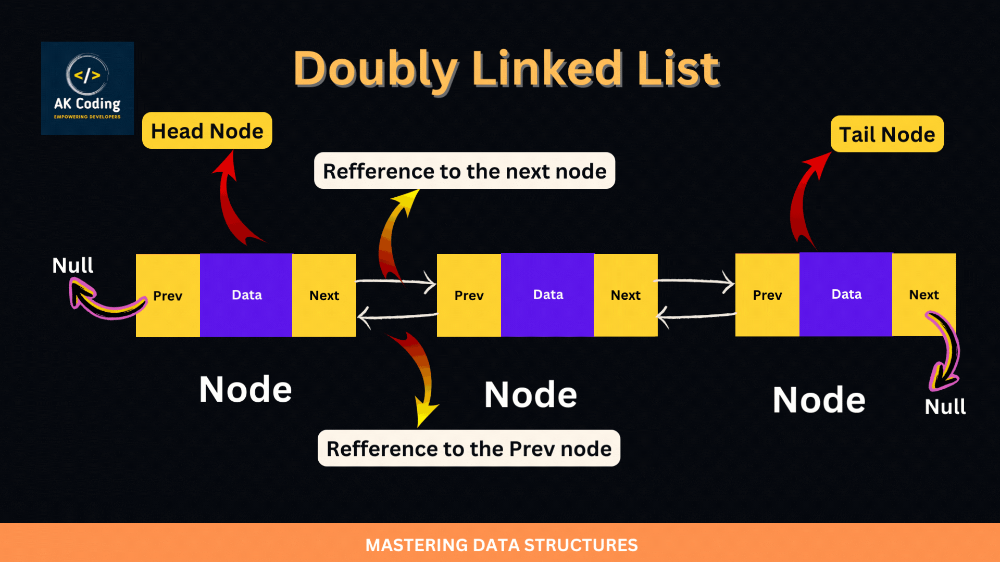; 
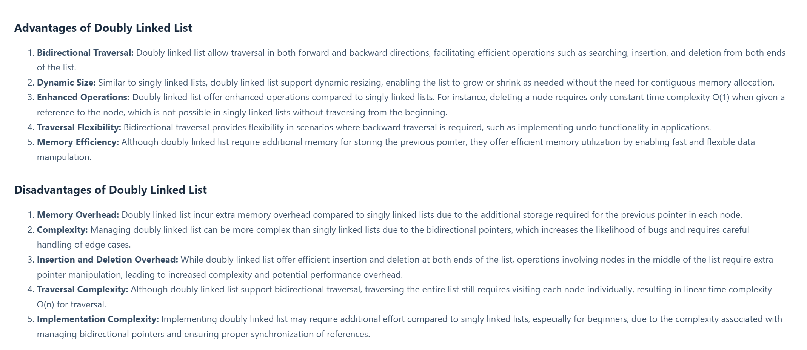; 

## Circular Linked List

### What Is a Circular Linked List?
A Circular Linked List is a variation of a Linked List where the **last node does not point to `nullptr`**. Instead, its `next` pointer points back to the `head` node!
This forms a closed loop, allowing continuous traversal without encountering a traditional end.

---

### Difference from Singly Linked List
* **Singly Linked List:** The tail node points to `nullptr`, marking the end of the list.
* **Circular Linked List:** The tail node points back to the `head` (`tail->next = head`).

---

### Main Types
1. **Circular Singly Linked List:** Nodes have a single `next` pointer, and the last node points to the first.
2. **Circular Doubly Linked List:** Nodes have both `next` and `prev` pointers. The last node points to the first, and the first node's `prev` points to the last.

---

### Pros and Cons

#### Pros
* **Continuous Traversal:** You can start at any node and traverse the entire list, eventually returning to the starting point.
* **Real-world Applications:** Perfect for Round-Robin scheduling in operating systems, multiplayer turn-based games, and looping media playlists.

---

#### Cons
* **Infinite Loops:** If traversal conditions are poorly written (forgetting the stop condition), your program will get stuck in an infinite loop.
* **Debugging Complexity:** Slightly harder to trace and debug compared to standard linear linked lists.

---

### Traversal Example (Display Function)
To print a circular linked list without getting stuck in an infinite loop, we use a `do-while` loop to ensure we stop once we circle back to the `head`:


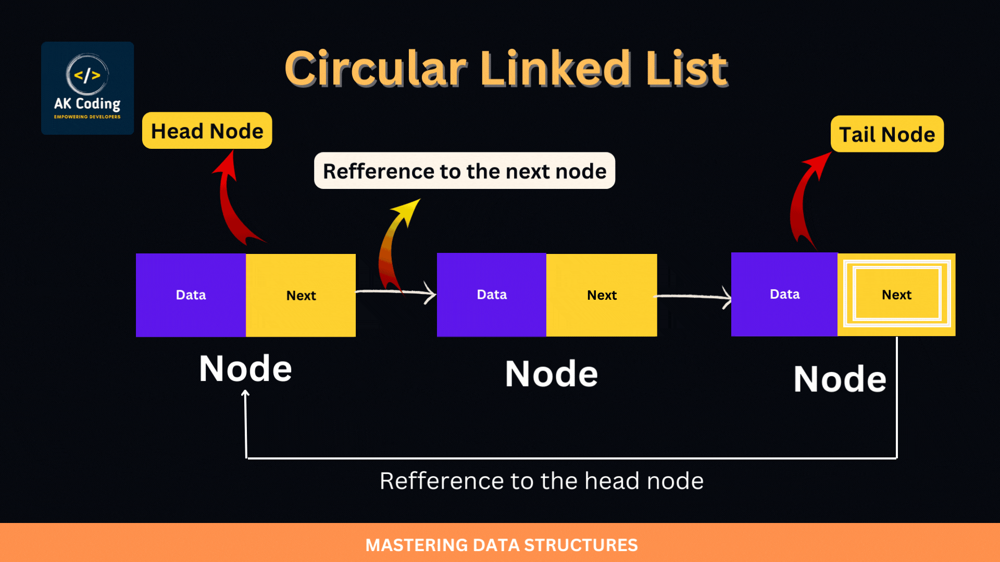


## Stack
 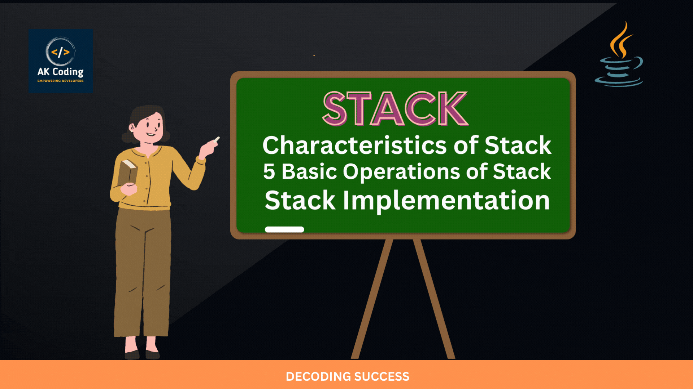
 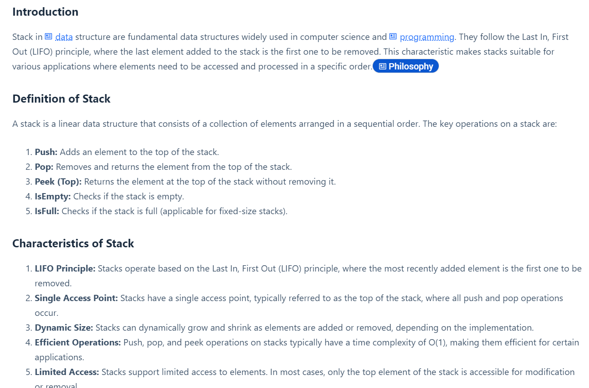
 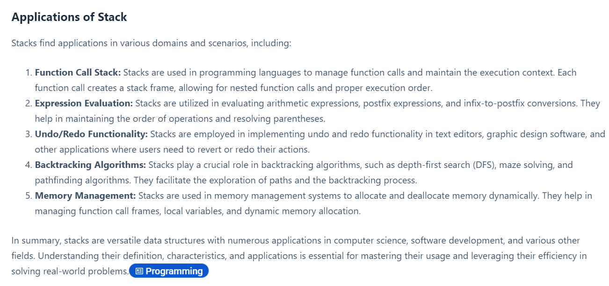
 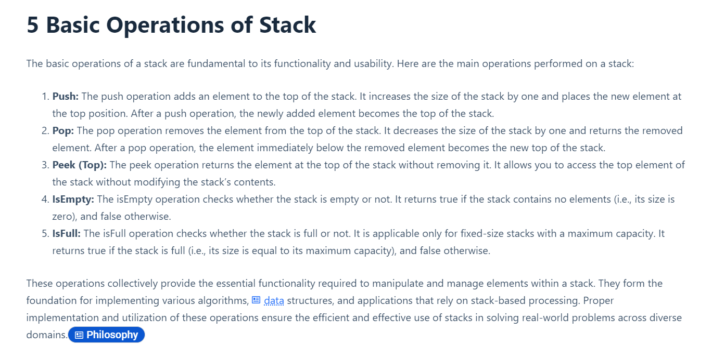
 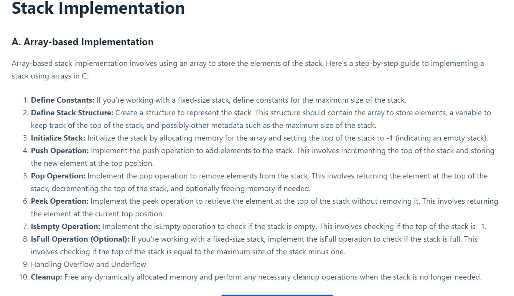
 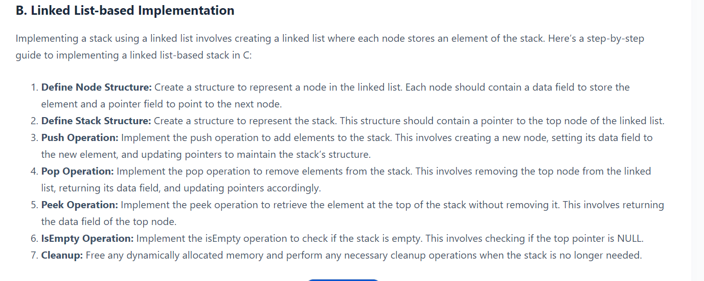


## Complexity Analysis in Data Structures & Algorithms

When evaluating code efficiency, we don't measure execution time in seconds (because it depends on the computers processor), instead, we measure how resource consumption grows relative to the input size ($N$).

### 1. Time Complexity
Measures how the execution time increases as the input size ($N$) grows.
* **$O(1)$ - Constant Time:** Operations take the exact same time regardless of input size (e.g., Array indexing, Stack `push`/`pop`).
* **$O(n)$ - Linear Time:** Execution time grows directly proportional to the input size (e.g., Traversing a Linked List, checking Balanced Parentheses).

### 2. Space Complexity
Measures how much extra memory (RAM) an algorithm consumes relative to the input size ($N$).
* **$O(1)$ - Constant Space:** Uses a fixed amount of extra memory regardless of input (e.g., iterative pointer variables).
* **$O(n)$ - Linear Space:** Memory consumption grows as input size increases (e.g., Storing elements in a Stack or recursive call stack).

### What Is the Need for Complexity Analysis?
- Complexity Analysis determines the amount of time and space resources required to execute it.
- It is used for comparing different algorithms on different input sizes.
- Complexity helps to determine the difficulty of a problem.
- often measured by how much time and space (memory) it takes to solve a particular problem

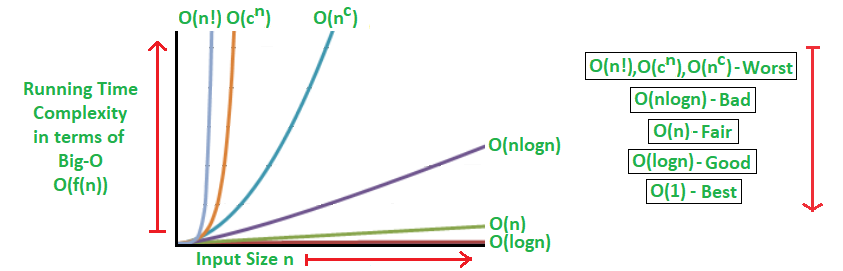

### Time Complexity
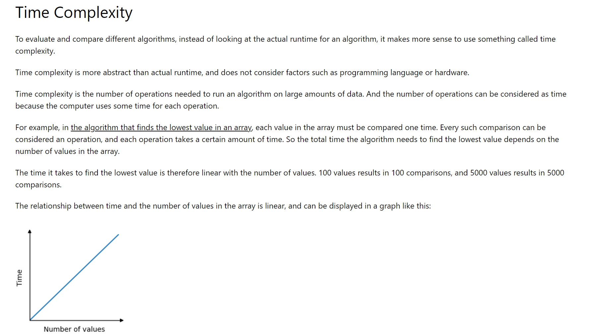

### Space Complexity

Space complexity = input space + auxiliary space (the temporary space an algorithm needs).

It quantifies the total memory an algorithm requires to run to completion as a function of the input length.


## Queue
Queue is a linear data structure that follows the First-In-First-Out (FIFO) principle: the first element added is the first one removed.

Its main operations are `enqueue`, which adds an element to the rear, and `dequeue`, which removes an element from the front. Queues also typically support `peek`, checking whether the queue is empty, and determining its size.

Queues are used in operating system scheduling, network packet routing, and simulations involving waiting lines.
  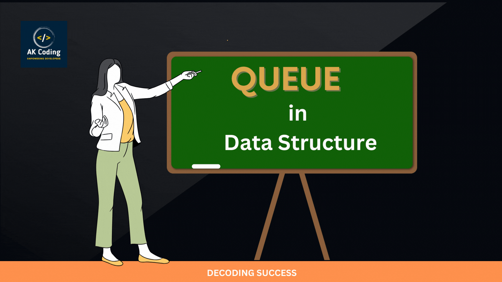

### Queue Operations

- Enqueue
- Dequeue
- Peek
- Is empty
- Get size

### Queue Implementations

#### Array-Based Queue
   array-based queue utilizes an array to store elements in a sequential manner. Elements are inserted at the rear end of the array and removed from the front end, adhering to the FIFO principle. The array needs to be dynamically resized when it reaches its capacity to accommodate additional elements.
##### Operations
- **Enqueue (addition):** Adds an element to the rear by appending it to the array. Time: $O(1)$ on average, $O(n)$ in the worst case when resizing is required.
- **Dequeue (removal):** Removes and returns the front element, then shifts the remaining elements. Time: $O(n)$.
- **Peek:** Returns the front element without removing it. Time: $O(1)$.
- **isEmpty:** Checks whether the array is empty. Time: $O(1)$.
- **Size:** Returns the number of elements in the array. Time: $O(1)$.
  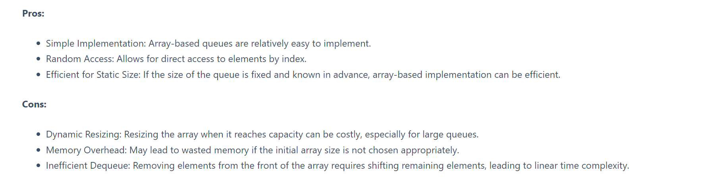

#### Linked-List-Based Queue
  A Linked List-based queue dynamically allocates memory for each element (node). It maintains two pointers: `front` (pointing to the head node for deletions) and `rear` (pointing to the tail node for insertions). This avoids array capacity limits and eliminates the need for element shifting.

##### Operations

- **Enqueue (addition):** Creates a node, links `rear->next` to it, and updates `rear`. If the queue is empty, both `front` and `rear` point to the new node. Time: $O(1)$.
- **Dequeue (removal):** Removes and frees the front node, then advances `front`. If `front` becomes `nullptr`, set `rear` to `nullptr` too. Time: $O(1)$.
- **Peek:** Returns the value at `front` (`front->data`) without removing it. Time: $O(1)$.
- **isEmpty:** Checks whether `front` is `nullptr`. Time: $O(1)$.
- **Size:** Returns the internal counter of active elements. Time: $O(1)$.
  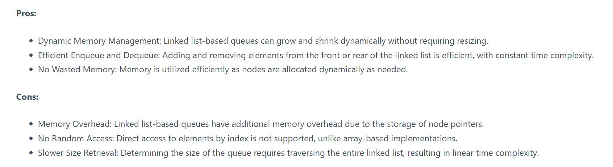;
  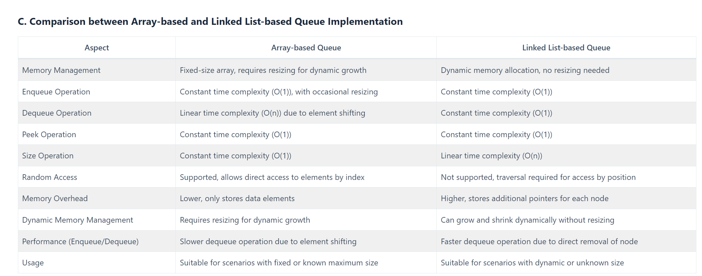;
### Circular Queue

  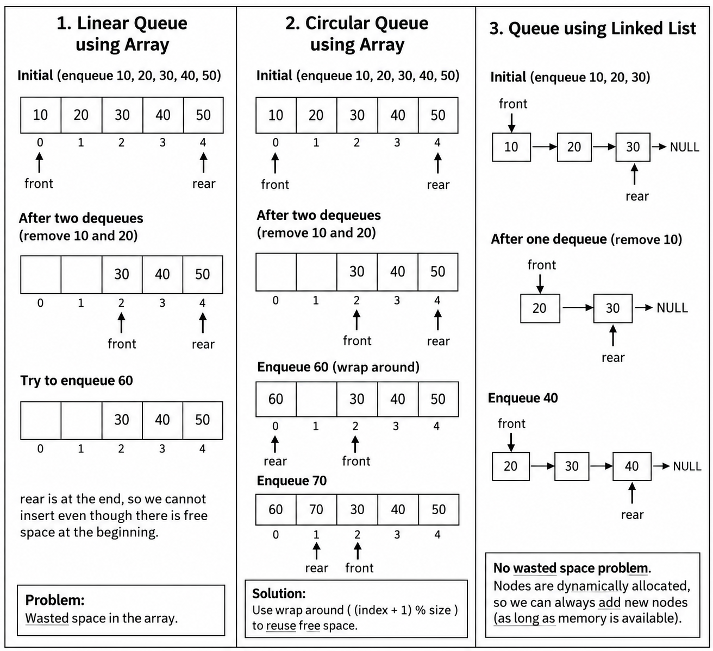;

#### Idea
A Circular Queue is a Queue implemented using an Array. It follows FIFO (First In, First Out). The main problem with a normal Array Queue is wasted space after removing elements. Circular Queue solves this by reusing the empty positions.

#### Main Variables
- `front` → points to the first element to remove.
- `rear` → points to the next position to insert.
- `count` → stores the number of elements.
- `capacity` → stores the maximum size.

#### Wrap Around
When `front` or `rear` reaches the last index, it goes back to index `0`.
Formula: `(index + 1) % capacity`
Example: if `capacity = 5`, then `4 → 0`.

#### Enqueue
`enqueue()` adds a new element.
1. Check if the Queue is full.
2. Insert the value at `rear`.
3. Move `rear` using the wrap-around formula.
4. Increase `count`.

Function:
```cpp
void enqueue(int value) {
    if (isFull()) return;
    arr[rear] = value;
    rear = (rear + 1) % capacity;
    count++;
}
```

#### Dequeue
`dequeue()` removes the first element.
1. Check if the Queue is empty.
2. Get the value at `front`.
3. Move `front` using the wrap-around formula.
4. Decrease `count`.
5. Return the removed value.

Function:
```cpp
int dequeue() {
    if (isEmpty()) return -1;
    int value = arr[front];
    front = (front + 1) % capacity;
    count--;
    return value;
}
```

#### Check Functions
`isEmpty()` returns true when `count == 0`.
`isFull()` returns true when `count == capacity`.

Functions:
```cpp
bool isEmpty() {
    return count == 0;
}

bool isFull() {
    return count == capacity;
}
```

#### Complete Implementation
```cpp
class CircularQueue {
    private:
    int* arr;
    int capacity;
    int front;
    int rear;
    int count;

public:
    CircularQueue(int size) {
        capacity = size;
        arr = new int[capacity];
        front = 0;
        rear = 0;
        count = 0;
    }

    bool isEmpty() {
        return count == 0;
    }

    bool isFull() {
        return count == capacity;
    }

    void enqueue(int value) {
        if (isFull()) return;

        arr[rear] = value;
        rear = (rear + 1) % capacity;
        count++;
    }

    int dequeue() {
        if (isEmpty()) return -1;

        int value = arr[front];
        front = (front + 1) % capacity;
        count--;

        return value;
    }
};
```

#### Complexity
- `enqueue()` → O(1)
- `dequeue()` → O(1)
- `isEmpty()` → O(1)
- `isFull()` → O(1)
- Space → O(n)

#### Key Point
Circular Queue = Queue + Array + Wrap Around.

The Queue still follows FIFO. The Circular idea only helps us reuse empty positions in the Array.


## Linear Search

### 1. Overview
Linear Search is a sequential search algorithm that starts from one end and traverses through each element of the array until the target element is found, or the end of the array is reached. It operates on both sorted and unsorted data structures.

### 2. Operations & Mechanism
1. Traverse the array from index `0` to `n - 1`.
2. Compare the current element with the target element.
3. If a match occurs, return the current index immediately.
4. If the loop completes without finding a match, return `-1`.

### 3. Complexity Analysis
- **Time Complexity:**
  - **Best Case:** $O(1)$ — Target is at the first index.
  - **Worst Case:** $O(n)$ — Target is at the last index or absent.
  - **Average Case:** $O(n)$ — Target is found near the middle.
- **Space Complexity:**
  - **Auxiliary Space:** $O(1)$ — Requires no additional memory beyond loop variables.
  - **Total Space:** $O(n)$ — Storage for the input array.

 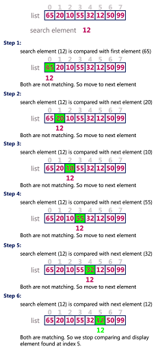;

## Binary Search

### 1. Overview
Binary Search is an efficient divide-and-conquer search algorithm designed for **sorted arrays**. It repeatedly divides the search interval in half by comparing the middle element to the target value.

### 2. Precondition
The input collection **must be sorted** prior to execution. Checking sorted order inside the function is avoided to preserve $O(\log n)$ runtime.

### 3. Algorithm Steps
1. Initialize two pointers: `low = 0` and `high = size - 1`.
2. While `low <= high`:
   - Compute the midpoint: $\text{mid} = \text{low} + \frac{\text{high} - \text{low}}{2}$.
   - If `arr[mid] == target`, return `mid`.
   - If `arr[mid] < target`, discard the left half (`low = mid + 1`).
   - If `arr[mid] > target`, discard the right half (`high = mid - 1`).
3. If `low > high`, the element is not present; return `-1`.

### 4. Complexity Analysis
- **Time Complexity:**
  - **Best Case:** $O(1)$ — Target is exactly at the initial midpoint.
  - **Worst Case:** $O(\log n)$ — Target is at the end of the split path or missing.
  - **Average Case:** $O(\log n)$.
- **Space Complexity:**
  - **Auxiliary Space:** $O(1)$ — Iterative approach uses only pointer variables.
  - **Total Space:** $O(n)$ — Input array storage.

 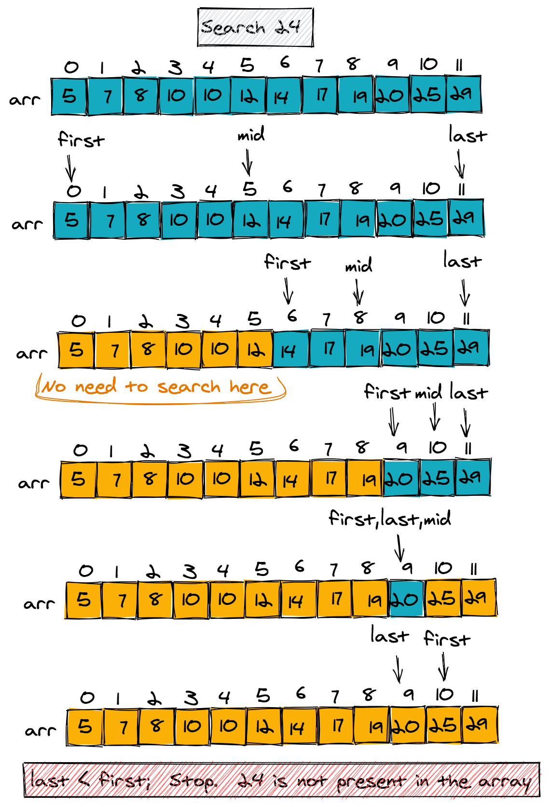;


## Binary Search: Iterative vs. Recursive Implementation

Binary Search is an efficient divide-and-conquer searching algorithm designed strictly for **sorted arrays**. It eliminates half of the remaining search space with every comparison, achieving a logarithmic runtime.

---

### 1. Algorithmic Precondition
* **Array Must Be Sorted:** The array must be in non-decreasing order prior to invoking binary search.
* **No Inline Validation:** Checking sorting order within the search function degrades time complexity to $O(n)$. Validation, if required, must be delegated to the caller or handled as a separate precondition check.

---

### 2. Iterative Approach

The iterative variant maintains explicit interval pointers inside a loop, updating boundary offsets without auxiliary function-call frames.

#### Implementation (C++)
```cpp
int binarySearchIterative(const int arr[], int size, int target) {
    int low = 0;
    int high = size - 1;

    while (low <= high) {
        // Prevent potential 32-bit signed integer overflow
        int mid = low + (high - low) / 2;

        if (arr[mid] == target) {
            return mid;
        }

        if (arr[mid] < target) {
            low = mid + 1;   // Narrow search to right half
        } else {
            high = mid - 1;  // Narrow search to left half
        }
    }

    return -1; // Target not found
}
```

### Recursive Approach

The recursive variant substitutes loop mechanics with self-invoking function calls, passing recalculated search intervals as arguments.

```cpp
int binarySearchRecursive(const int arr[], int low, int high, int target) {
    // Base Case 1: Search interval collapsed
    if (low > high) {
        return -1;
    }

    int mid = low + (high - low) / 2;

    // Base Case 2: Target located
    if (arr[mid] == target) {
        return mid;
    }

    // Recursive Case: Target resides in right partition
    if (arr[mid] < target) {
        return binarySearchRecursive(arr, mid + 1, high, target);
    }

    // Recursive Case: Target resides in left partition
    return binarySearchRecursive(arr, low, mid - 1, target);
}
 ```
 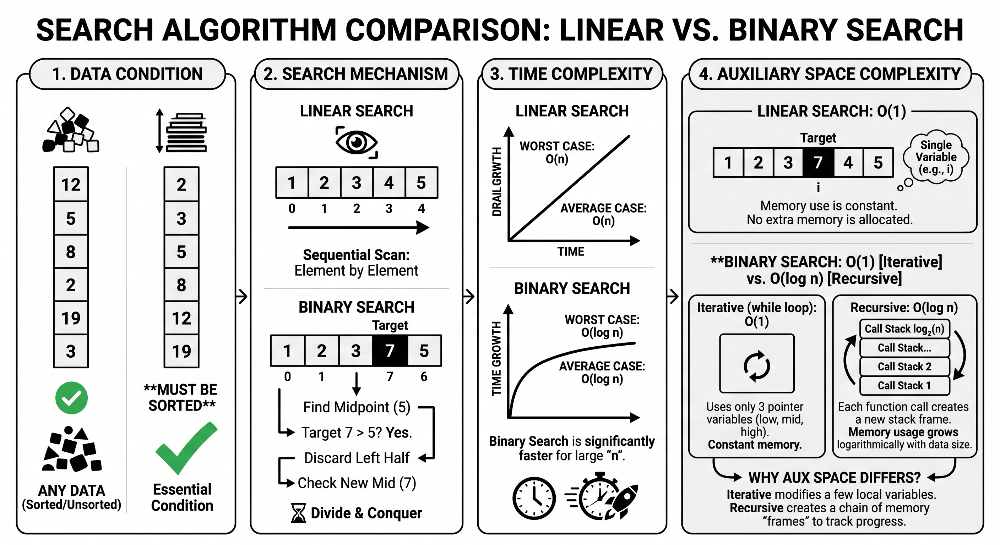

## Binary Search: Lower Bound & Upper Bound

Both **Lower Bound** and **Upper Bound** are essential variations of the **Binary Search** algorithm. They work on **sorted arrays** and allow us
to handle duplicate values, find insertion positions, and solve range queries efficiently in O(log n) time.
- The array must be sorted.
---

### 1. What Is Lower Bound?

* **Definition:** It finds the index of the **first element** that is **greater than or equal to (>=)** the target value.
* **Core Idea:** "What is the earliest valid index where this value can appear or be inserted while keeping the array sorted?"
* **Search Logic:**
  * If `arr[mid] >= target`: Save `mid` as a valid answer, then search the **left half** (`high = mid - 1`) to check if an earlier match exists.
  * If `arr[mid] < target`: Search the **right half** (`low = mid + 1`).

---

### 2. What Is Upper Bound?

* **Definition:** It finds the index of the **first element** that is **strictly greater than (>)** the target value.
* **Core Idea:** "What is the first index right after all occurrences of this target value?"
* **Search Logic:**
  * If `arr[mid] > target`: Save `mid` as a valid answer, then search the **left half** (`high = mid - 1`) to check for an earlier element that is also greater.
  * If `arr[mid] <= target`: Search the **right half** (`low = mid + 1`).

---

### 3. Visual Example & Difference

Given a sorted array with duplicates:
`arr = [10, 20, 20, 20, 30, 40]` and `target = 20`:

```text
Indices:   [0]   [1]   [2]   [3]   [4]   [5]
Values:     10    20    20    20    30    40
                  ^                 ^
                  |                 +-- Upper Bound (Index 4, Value 30: first element > 20)
                  +-------------------- Lower Bound (Index 1, Value 20: first element >= 20)
```

- **Lower Bound of 20:** Index 1 (first element >= 20).

- **Upper Bound of 20:** Index 4 (first element > 20).

- **Frequency:** Upper Bound - Lower Bound = 4 - 1 = 3.

```cpp
#include <iostream>
using namespace std;

// Lower Bound: First index where arr[index] >= target
int lowerBound(const int arr[], int size, int target) {
    int low = 0;
    int high = size - 1;
    int ans = size; // Default: returned if all elements are smaller than target

    while (low <= high) {
        int mid = low + (high - low) / 2;

        if (arr[mid] >= target) {
            ans = mid;         // Mid is a valid candidate
            high = mid - 1;    // Try to find a smaller index to the left
        } else {
            low = mid + 1;     // Target is larger, go to the right
        }
    }
    return ans;
}

// Upper Bound: First index where arr[index] > target
int upperBound(const int arr[], int size, int target) {
    int low = 0;
    int high = size - 1;
    int ans = size; // Default: returned if no element is strictly greater

    while (low <= high) {
        int mid = low + (high - low) / 2;

        if (arr[mid] > target) {
            ans = mid;         // Mid is a valid candidate
            high = mid - 1;    // Try to find a smaller index to the left
        } else {
            low = mid + 1;     // Value is <= target, go to the right
        }
    }
    return ans;
}

int main() {
    int arr[] = {10, 20, 20, 20, 30, 40};
    int size = sizeof(arr) / sizeof(arr[0]);
    int target = 20;

    int lb = lowerBound(arr, size, target);
    int ub = upperBound(arr, size, target);

    cout << "Array: {10, 20, 20, 20, 30, 40}\n";
    cout << "Target: " << target << "\n";
    cout << "--------------------------------\n";
    cout << "Lower Bound index (arr[i] >= " << target << "): " << lb << "\n";
    cout << "Upper Bound index (arr[i] > " << target << "):  " << ub << "\n";
    cout << "Total Count of target (" << target << "):        " << (ub - lb) << "\n";

    return 0;
}
```

### 3 Practical Applications of Lower & Upper Bound

* **Count Frequency:**
  * It counts how many times a specific number appears in a sorted array.
  * You simply subtract: `upper_bound(target) - lower_bound(target)` in O(log n) time.

* **Insertion Point:**
  * It tells you the exact index to insert a new number so the array stays sorted.
  * You just run `lower_bound(new_value)`, which points directly to that correct position.

* **Range Queries:**
  * It counts how many numbers exist between two values `[L, R]`.
  * You find the boundaries with `upper_bound(R) - lower_bound(L)` without looping through elements.


## Bubble Sort Algorithm

Bubble Sort is a simple, comparison-based sorting algorithm. It works by repeatedly stepping through the list, comparing adjacent elements, and swapping them if they are in the wrong order. With each full pass, the largest unsorted element "bubbles up" to its correct position at the end of the array.

---

### 1. How It Works (Core Logic)
* **Adjacent Comparisons:** Compare two neighboring items (`arr[j]` and `arr[j + 1]`).
* **Swap Condition:** If the left item is greater than the right item, swap them.
* **Pass Completion:** After pass `i`, the largest remaining value settles at index `n - i - 1`.
* **Outer Loop:** Controls the number of passes (`0` to `n - 2`).
* **Inner Loop:** Handles comparisons and shrinks after each pass (`0` to `n - i - 1`).

---

### 2. Early-Exit Optimization
* Use a boolean flag (`swapped = false`) before each pass.
* If a swap occurs, set `swapped = true`.
* If a pass finishes with **zero swaps**, the array is already sorted, so stop immediately (`break`).

---

### 3. Complexity & Characteristics

- **Best-case time:** $O(n)$. Already-sorted data finishes after one pass using the swap flag.
- **Average-case time:** $O(n^2)$ for randomly ordered data.
- **Worst-case time:** $O(n^2)$ for reverse-ordered data.
- **Auxiliary space:** $O(1)$ because the sort is in place.
- **Stability:** Stable; relative order of duplicate elements is preserved.
- **Comparisons:** $\frac{n(n - 1)}{2} \approx O(n^2)$ across all passes.
- **Worst-case swaps:** $\frac{n(n - 1)}{2} \approx O(n^2)$ when every comparison triggers a swap.

---

### 4. When to Use & When to Avoid
* **When to use:** Educational purposes, checking if data is nearly sorted, or very small datasets ($n < 50$).
* **When to avoid:** Large datasets ($n > 1000$), where $O(n^2)$ operations become extremely slow.

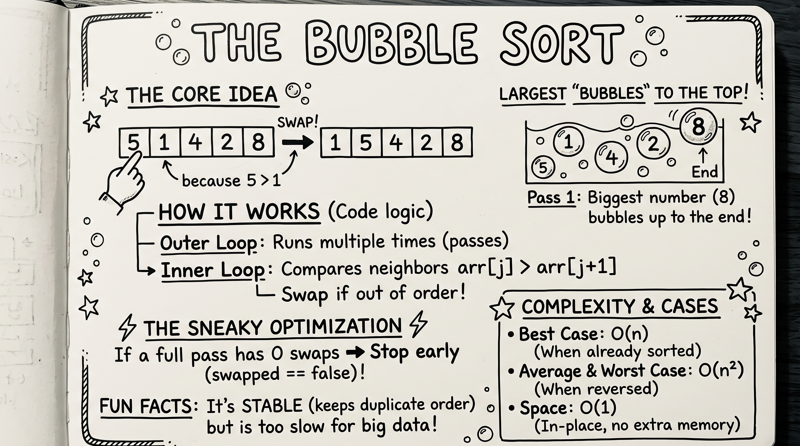

## Cocktail Sort
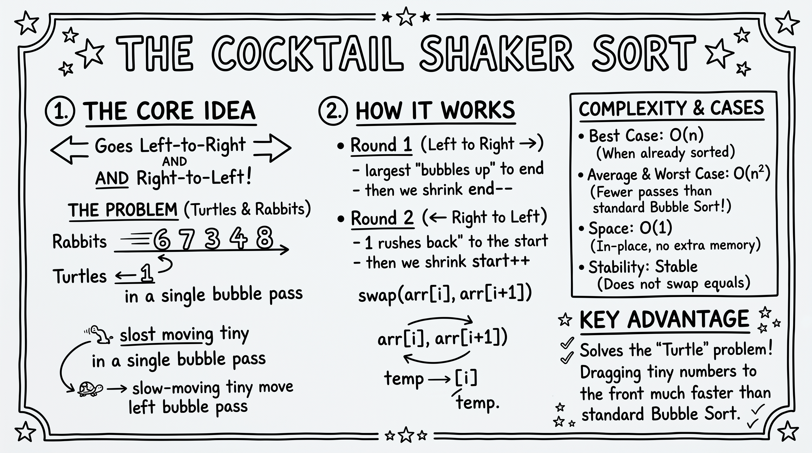

## Selection Sort Algorithm

Selection Sort is an in-place, comparison-based sorting algorithm. It conceptually divides the array into a sorted prefix on the left and an unsorted segment on the right, progressively placing the smallest remaining item into its correct slot.

---

### Core Mechanics
* **Prefix Division:** The left portion grows as elements are sorted; the right portion shrinks.
* **Minimum Search:** In pass `i`, assume the element at `i` is the minimum (`minIndex = i`), then scan from `i + 1` to `n - 1` to find the true minimum value.
* **Single Swap:** Swap `arr[i]` with `arr[minIndex]` only if `minIndex != i`.
* **Step Forward:** Increment `i` and repeat until the final element is reached.

---

### Complexity & Behavior
* **Best Case:** $O(n^2)$ — Scans all remaining elements even if already ordered.
* **Average Case:** $O(n^2)$ — Standard performance across randomized inputs.
* **Worst Case:** $O(n^2)$ — Occurs with reversed or arbitrary inputs due to full scans.
* **Auxiliary Space:** $O(1)$ — Requires only minimal index tracking variables.
* **Stability:** Unstable — Swapping across distance can invert identical keys.
* **Total Comparisons:** $\frac{n(n - 1)}{2} \approx O(n^2)$ — Exact comparison count across all runs.
* **Total Swaps:** At most $n - 1 \implies O(n)$ — Minimizes memory write overhead.

---

### Practical Fit
* **Preferred:** Systems with high memory-write costs (such as Flash memory or EEPROM) due to low swap volume.
* **Avoided:** Large arrays ($n > 1000$), or workflows requiring strict stability.
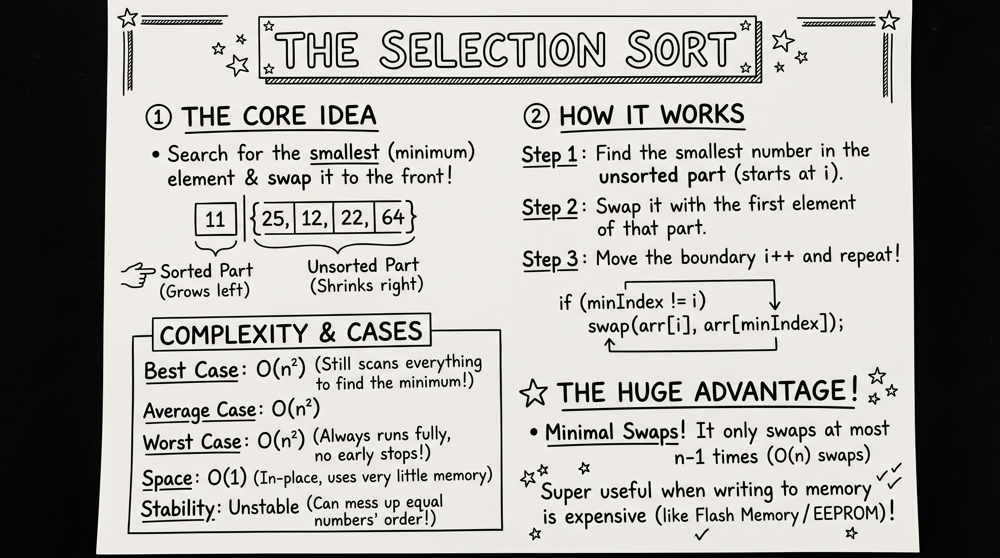

# Insertion Sort Algorithm

Insertion Sort is an intuitive, comparison-based sorting algorithm that builds the final sorted array one item at a time. It mimics the natural way people sort playing cards in their hands.

---

### Core Mechanics
* **Virtual Partitioning:** The array is conceptually split into a sorted section on the left and an unsorted section on the right.
* **Key Extraction:** In pass `i` (starting from index `1`), store `arr[i]` in a temporary variable named `key`.
* **Backward Shifting:** Compare the `key` with preceding elements from right to left (`j = i - 1` down to `0`). As long as `arr[j] > key`, shift `arr[j]` one position to the right (`arr[j + 1] = arr[j]`).
* **Insertion:** Once an element smaller than or equal to the `key` is found (or the beginning is reached), insert the `key` into the created gap at `arr[j + 1]`.

---

### Complexity & Behavior
* **Best Case (Time):** $O(n)$ — Occurs when the array is already sorted; the inner condition fails immediately on each pass with zero shifts.
* **Average Case (Time):** $O(n^2)$ — Standard performance across randomized input sets.
* **Worst Case (Time):** $O(n^2)$ — Occurs when the array is in reverse order; requires maximum shifts for every element.
* **Auxiliary Space:** $O(1)$ — In-place algorithm; uses minimal memory overhead (`key` and loop counters).
* **Stability:** Stable — Does not change the relative position of equal elements because shifting only occurs when `arr[j] > key`.

---

### Practical Fit & Strengths
* **Nearly Sorted Datasets:** Exceptionally fast ($O(n)$) when data is already mostly sorted.
* **Small Datasets:** Highly efficient with very low constant-factor overhead, often used as the base case in hybrid algorithms like Timsort and Introsort.
* **Online Processing:** Capable of sorting a streaming list as items arrive in real-time.
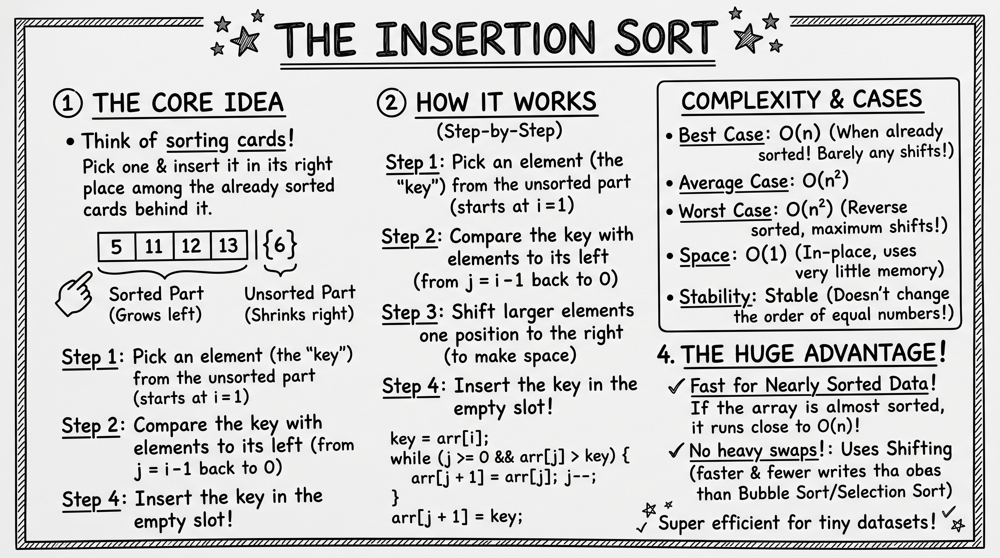
